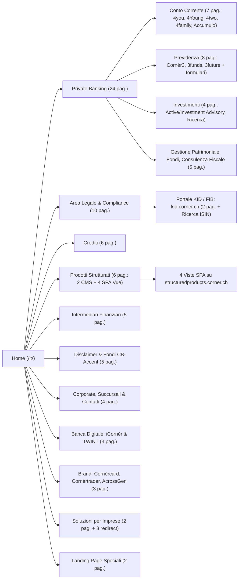

# Mappa Completa e Analisi Architetturale di corner.ch (73 Pagine)
> [!NOTE]
> L'ecosistema `corner.ch` è strutturato in **4 lingue speculari** (`/it/`, `/de/`, `/fr/`, `/en/`). La mappatura integrale della sezione italiana (`/it/`) comprende **73 pagine**: **66 pagine CMS OpenCms** (`www.corner.ch/it/*`), **4 viste Single-Page Application (Vue.js)** sul portale dei prodotti strutturati (`structuredproducts.corner.ch`), **2 pagine sul microsito normativo LSerFi** (`kid.corner.ch/it/` e `/it/information/`) e **1 portale carriere** (`jobs.corner.ch/l/it/`), oltre a **5 URL con reindirizzamento 302 cross-sezione**, per un totale di **~292 pagine** sull'intero ecosistema multilingua.

## 1. Schema Architetturale ad Albero (Mermaid)

## 2. Statistiche sulla Composizione del Sito
| Metrica | Valore | Dettaglio |
|---|---|---|
| **Pagine Totali Mappate (`/it/`)** | **73** | 66 su `www.corner.ch/it/*` + 4 SPA su `structuredproducts.corner.ch` + 2 su `kid.corner.ch` + 1 su `jobs.corner.ch` |
| **Copertura Titoli & Descrizioni** | **100%** | 69 pagine con `<title>` statico + 4 viste SPA con `document.title` dinamico via Vue Router |
| **Collegamenti Contestuali (In-Body)** | **267** | Media di **3,7 link contestuali** per pagina (esclusi menu header/footer) |
| **Voci di Navigazione Globale (Header/Footer)** | **39** | Link presenti in modo fisso su 65–66 pagine standard del CMS |
| **Documenti PDF Unici** | **70 + DB ISIN** | 54 PDF su `www.corner.ch` + 16 prospetti PDF su `structuredproducts.corner.ch` + repository FIB per ISIN su `kid.corner.ch` |
| **Lunghezza Media Contenuto** | **511 parole** | Min: ~120 parole (pagine disclaimer/form) • Max: **6.354 parole** (Privacy Policy) |
| **Sottodomini Integrati** | **4** | `www.corner.ch`, `structuredproducts.corner.ch`, `kid.corner.ch`, `jobs.corner.ch` |
| **Reindirizzamenti Interni (301 / 302)** | **4 + 5** | 4 redirect `301` verso la SPA `structuredproducts.corner.ch` + 5 redirect `302` cross-sezione |

### Il Portale Esterno `kid.corner.ch` (Fogli Informativi di Base — LSerFi)
Il sottodominio `https://kid.corner.ch` è un microsito normativo basato su Symfony (`docrepositorymicrosite`), disponibile nelle 4 lingue (`/it/`, `/de/`, `/fr/`, `/en/`), realizzato per adempiere agli obblighi della **Legge federale sui servizi finanziari (LSerFi)** in materia di **Fogli Informativi di Base (FIB / KID)**:
1. **`https://kid.corner.ch/it/` — Fogli informativi di base (FIB) - Cornèr Banca SA**:
   - **Meta Description**: `i documenti con le informazioni chiave sono disponibili su questo sito web`
   - **Funzionamento a 2 stadi**: al primo accesso mostra l'informativa legale LSerFi e un gate di verifica cliente (*"Conferma di essere un cliente di Cornèr Banca SA"*). Confermando tramite chiamata AJAX `POST /it/set-domicile/` (`commonDisclaimerResult=option1`), la sessione (`PHPSESSID`) viene sbloccata e la medesima URL renderizza il **motore di ricerca per codice ISIN** (`POST /it/search-result/`), che restituisce i PDF dei FIB per fondi, prodotti strutturati e obbligazioni.
2. **`https://kid.corner.ch/it/information/` — Informazioni sulla pagina - Cornèr Banca SA**:
   - **Meta Description**: `i documenti con le informazioni chiave sono disponibili su questo sito web`
   - **Contenuto**: spiega finalità, ambito di applicazione e modalità di ricerca tramite numero ISIN (International Securities Identification Number) dei Fogli Informativi di Base.
3. **Collegamenti con `www.corner.ch`**: entrambe le pagine di `kid.corner.ch` sono collegate direttamente alla Home (`https://www.corner.ch/it/`), all'Area Legale (`https://www.corner.ch/it/area-legale/`), alla Cookie Policy (`https://www.corner.ch/it/area-legale/cookie-policy/`) e all'Informativa sulla protezione dei dati (`https://www.corner.ch/it/area-legale/informativa-sulla-protezione-dei-dati/`).

### Come funzionano le 4 sottopagine di "Prodotti Strutturati" (`structuredproducts.corner.ch`)
1. **Redirect 301 dal CMS principale**: Gli URL `/it/prodotti-strutturati/i-nostri-prodotti/`, `prodotti-in-sottoscrizione/`, `opportunita-sul-mercato-secondario/` e `prospetti-e-notifiche/` rispondono con `HTTP 301 Moved Permanently` verso `https://structuredproducts.corner.ch/...?language_id=5`.
2. **Architettura Single-Page Application (Vue.js)**: Il server di `structuredproducts.corner.ch` restituisce sui deep-link lo shell HTML della SPA (`1.868 byte` con `

` e `/resources/js/main.js`), e il router Vue lato client risolve le 4 viste interrogando `/api/language-variables/json?lang=it&country=CH` e `/content/prospectuses.json?language_id=5`.

## 3. Catalogo Completo delle 73 Pagine (Titolo, Descrizione e Collegamenti)
### Corporate & Contatti (4 pagine)
| Percorso URL | Titolo (`<title>`) | Meta Description / Contenuto | Link Contestuali (In / Out) | PDF |
|---|---|---|---|---|
| [`/l/it/ (jobs.corner.ch)`](https://jobs.corner.ch/l/it/) | **Jobs and Careers at Cornèr Bank** | Jobs and Careers at Cornèr Bank | **1 in entrata** da: `/it/landing/friendly-work-space/` **0 in uscita** | 0 |
| [`/it/contatti/`](https://www.corner.ch/it/contatti/) | **Contattaci: hai una richiesta per noi? \| Cornèr** | Hai una richiesta da farci? Oppure vuoi essere contattato da un nostro specialista? Entra e compila il form. | **34 in entrata** da: `/it/, /it/acrossgen/, /it/area-legale/documenti-per-controparti-bancarie/` (+31) **2 in uscita**: `/it/area-legale/informativa-sulla-protezione-dei-dati/, /it/sede-succursali-agenzie/` | 0 |
| [`/it/gruppo-corner/`](https://www.corner.ch/it/gruppo-corner/) | **Gruppo Cornèr: un Gruppo bancario svizzero \| Cornèr** | Il Gruppo Cornèr è un Gruppo bancario privato e indipendente che propone una gamma completa di servizi e prodotti per clienti privati, aziendali e istituzionali. | **1 in entrata** da: `/it/` **0 in uscita** | 0 |
| [`/it/sede-succursali-agenzie/`](https://www.corner.ch/it/sede-succursali-agenzie/) | **Sede, succursali e agenzie: trova la tua filiale \| Cornèr** | Vuoi fare visita a uno dei nostri sportelli? Scopri qual è la filiale più vicina a te consultando la pagina Sede, succursali e agenzie. | **2 in entrata** da: `/it/contatti/, /it/soluzioni-per-imprese/` **1 in uscita**: `/it/contatti/` | 0 |

### Portale KID / FIB (kid.corner.ch) (2 pagine)
| Percorso URL | Titolo (`<title>`) | Meta Description / Contenuto | Link Contestuali (In / Out) | PDF |
|---|---|---|---|---|
| [`/it/ (kid.corner.ch)`](https://kid.corner.ch/it/) | **Fogli informativi di base (FIB) - Cornèr Banca SA** | i documenti con le informazioni chiave sono disponibili su questo sito web — Portale normativo LSerFi di Cornèr Banca SA con gate di verifica cliente (POST /it/set-domicile/) e motore di ricerca per codice ISIN (POST /it/search-result/) dei Fogli Informativi di Base (FIB / KID). | **3 in entrata** da: `https://kid.corner.ch/it/information/, /it/area-legale/, /it/area-legale/informative-regolamentari/` **5 in uscita**: `https://kid.corner.ch/it/information/, /it/, /it/area-legale/, /it/area-legale/cookie-policy/` (+1) | 1 |
| [`/it/information/ (kid.corner.ch)`](https://kid.corner.ch/it/information/) | **Informazioni sulla pagina - Cornèr Banca SA** | i documenti con le informazioni chiave sono disponibili su questo sito web — Guida all'utilizzo dei Fogli Informativi di Base (FIB) ai sensi della Legge federale sui servizi finanziari (LSerFi) per investimenti collettivi di capitale, prodotti strutturati e obbligazioni tramite ricerca ISIN. | **1 in entrata** da: `https://kid.corner.ch/it/` **5 in uscita**: `https://kid.corner.ch/it/, /it/, /it/area-legale/, /it/area-legale/cookie-policy/` (+1) | 0 |

### Home (1 pagine)
| Percorso URL | Titolo (`<title>`) | Meta Description / Contenuto | Link Contestuali (In / Out) | PDF |
|---|---|---|---|---|
| [`/it/`](https://www.corner.ch/it/) | **Cornèr: Private Banking, crediti e soluzioni per imprese** | Dal 1952, siamo al tuo fianco per aiutarti a realizzare i tuoi desideri: i tuoi successi sono la nostra più grande soddisfazione. Scopri come possiamo aiutarti. | **3 in entrata** da: `https://kid.corner.ch/it/, https://kid.corner.ch/it/information/, /it/area-legale/note-legali/` **16 in uscita**: `/it/acrossgen/, /it/banca-digitale/, /it/banca-digitale/icorner/, /it/contatti/` (+12) | 0 |

### Brand & Piattaforme (3 pagine)
| Percorso URL | Titolo (`<title>`) | Meta Description / Contenuto | Link Contestuali (In / Out) | PDF |
|---|---|---|---|---|
| [`/it/acrossgen/`](https://www.corner.ch/it/acrossgen/) | **AcrossGen \| Cornèr** | AcrossGen. Dal 1952, siamo al tuo fianco per aiutarti a realizzare i tuoi desideri: i tuoi successi sono la nostra più grande soddisfazione. Scopri come possiamo aiutarti. | **1 in entrata** da: `/it/` **2 in uscita**: `/it/contatti/, /it/private-banking/gestione-patrimoniale/` | 0 |
| [`/it/cornercard/`](https://www.corner.ch/it/cornercard/) | **Cornèrcard: carte di credito sicure e innovative \| Cornèr** | Cornèrcard è il marchio di Cornèr Banca SA che opera nell’emissione di carte di pagamento, con un’attenzione particolare all’innovazione e alla sicurezza. | **1 in entrata** da: `/it/` **0 in uscita** | 0 |
| [`/it/cornertrader/`](https://www.corner.ch/it/cornertrader/) | **Cornèrtrader: la piattaforma di trading online \| Cornèr** | Cornèrtrader è una piattaforma di trading online multi-prodotto, compatibile con tutti i device e i sistemi operativi, che ti permette di investire in tutto il mondo. | **1 in entrata** da: `/it/` **0 in uscita** | 0 |

### Area Legale & Compliance (10 pagine)
| Percorso URL | Titolo (`<title>`) | Meta Description / Contenuto | Link Contestuali (In / Out) | PDF |
|---|---|---|---|---|
| [`/it/area-legale/`](https://www.corner.ch/it/area-legale/) | **Area legale \| Cornèr** | Area legale. Dal 1952, siamo al tuo fianco per aiutarti a realizzare i tuoi desideri: i tuoi successi sono la nostra più grande soddisfazione. Scopri come possiamo aiutarti. | **2 in entrata** da: `https://kid.corner.ch/it/, https://kid.corner.ch/it/information/` **10 in uscita**: `https://kid.corner.ch/it/, /it/area-legale/cookie-policy/, /it/area-legale/documenti-per-controparti-bancarie/, /it/area-legale/garanzia-dei-depositi-per-la-svizzera/` (+6) | 0 |
| [`/it/area-legale/cookie-policy/`](https://www.corner.ch/it/area-legale/cookie-policy/) | **Politica dei cookie \| Cornèr** | Politica dei cookie. Dal 1952, siamo al tuo fianco per aiutarti a realizzare i tuoi desideri: i tuoi successi sono la nostra più grande soddisfazione. Scopri come possiamo aiutarti. | **4 in entrata** da: `https://kid.corner.ch/it/, https://kid.corner.ch/it/information/, /it/area-legale/` (+1) **0 in uscita** | 0 |
| [`/it/area-legale/documenti-per-controparti-bancarie/`](https://www.corner.ch/it/area-legale/documenti-per-controparti-bancarie/) | **Documenti per controparti bancarie \| Cornèr** | Documenti per controparti bancarie. Dal 1952, siamo al tuo fianco per aiutarti a realizzare i tuoi desideri: i tuoi successi sono la nostra più grande soddisfazione. Scopri come possiamo aiutarti. | **1 in entrata** da: `/it/area-legale/` **1 in uscita**: `/it/contatti/` | 10 |
| [`/it/area-legale/garanzia-dei-depositi-per-la-svizzera/`](https://www.corner.ch/it/area-legale/garanzia-dei-depositi-per-la-svizzera/) | **Garanzia dei depositi per la Svizzera \| Cornèr** | Garanzia dei depositi per la Svizzera. Dal 1952, siamo al tuo fianco per aiutarti a realizzare i tuoi desideri: i tuoi successi sono la nostra più grande soddisfazione. Scopri come possiamo aiutarti. | **1 in entrata** da: `/it/area-legale/` **0 in uscita** | 0 |
| [`/it/area-legale/informativa-comunicazione-dati/`](https://www.corner.ch/it/area-legale/informativa-comunicazione-dati/) | **Informativa sulla comunicazione di dati del cliente per transazioni e/o servizi di investimento, in particolare con riferimento all’estero \| Cornèr** | Informativa sulla comunicazione di dati del cliente per transazioni e/o servizi di investimento, in particolare con riferimento all’estero. Dal 1952, siamo al tuo fianco per aiutarti a realizzare i tuoi desideri: i tuoi successi sono la nostra più grande soddisfazione. Scopri come possiamo aiutarti. | **1 in entrata** da: `/it/area-legale/` **1 in uscita**: `/it/contatti/` | 0 |
| [`/it/area-legale/informativa-sulla-protezione-dei-dati/`](https://www.corner.ch/it/area-legale/informativa-sulla-protezione-dei-dati/) | **Informativa sulla protezione dei dati \| Cornèr** | Informativa sulla protezione dei dati. Dal 1952, siamo al tuo fianco per aiutarti a realizzare i tuoi desideri: i tuoi successi sono la nostra più grande soddisfazione. Scopri come possiamo aiutarti. | **12 in entrata** da: `https://kid.corner.ch/it/, https://kid.corner.ch/it/information/, /it/area-legale/` (+9) **1 in uscita**: `/it/area-legale/cookie-policy/` | 0 |
| [`/it/area-legale/informative-per-clientela-residente-in-italia/`](https://www.corner.ch/it/area-legale/informative-per-clientela-residente-in-italia/) | **Informative per clientela residente in Italia \| Cornèr** | Informative per clientela residente in Italia. Dal 1952, siamo al tuo fianco per aiutarti a realizzare i tuoi desideri: i tuoi successi sono la nostra più grande soddisfazione. Scopri come possiamo aiutarti. | **1 in entrata** da: `/it/area-legale/` **0 in uscita** | 8 |
| [`/it/area-legale/informative-regolamentari/`](https://www.corner.ch/it/area-legale/informative-regolamentari/) | **Informative regolamentari \| Cornèr** | Informative regolamentari. Dal 1952, siamo al tuo fianco per aiutarti a realizzare i tuoi desideri: i tuoi successi sono la nostra più grande soddisfazione. Scopri come possiamo aiutarti. | **1 in entrata** da: `/it/area-legale/` **2 in uscita**: `https://kid.corner.ch/it/, /it/contatti/` | 20 |
| [`/it/area-legale/note-legali/`](https://www.corner.ch/it/area-legale/note-legali/) | **Note legali \| Cornèr** | Note legali. Dal 1952, siamo al tuo fianco per aiutarti a realizzare i tuoi desideri: i tuoi successi sono la nostra più grande soddisfazione. Scopri come possiamo aiutarti. | **1 in entrata** da: `/it/area-legale/` **2 in uscita**: `/it/, /it/contatti/` | 0 |
| [`/it/area-legale/reclami/`](https://www.corner.ch/it/area-legale/reclami/) | **Reclami \| Cornèr** | Reclami. Dal 1952, siamo al tuo fianco per aiutarti a realizzare i tuoi desideri: i tuoi successi sono la nostra più grande soddisfazione. Scopri come possiamo aiutarti. | **1 in entrata** da: `/it/area-legale/` **0 in uscita** | 0 |

### Banca Digitale (3 pagine)
| Percorso URL | Titolo (`<title>`) | Meta Description / Contenuto | Link Contestuali (In / Out) | PDF |
|---|---|---|---|---|
| [`/it/banca-digitale/`](https://www.corner.ch/it/banca-digitale/) | **Banca digitale: i servizi online \| Cornèr** | Vogliamo darti la possibilità di accedere ai nostri prodotti e servizi gratuitamente, ovunque tu sia: ecco una gamma completa e sicura di servizi online. | **1 in entrata** da: `/it/` **4 in uscita**: `/it/banca-digitale/icorner/, /it/banca-digitale/twint/, /it/contatti/, /it/intermediari-finanziari/servizi-online/` | 0 |
| [`/it/banca-digitale/icorner/`](https://www.corner.ch/it/banca-digitale/icorner/) | **iCornèr App: un unico login per tutti i servizi \| Cornèr** | iCornèr è la nostra app per effettuare pagamenti, fare le tue operazioni bancarie, accedere a Cornèrtrader e molto altro con un unico login. | **3 in entrata** da: `/it/, /it/banca-digitale/, /it/private-banking/conto-corrente/corner4young/` **1 in uscita**: `/it/contatti/` | 0 |
| [`/it/banca-digitale/twint/`](https://www.corner.ch/it/banca-digitale/twint/) | **TWINT \| Cornèr** | Con l | **2 in entrata** da: `/it/banca-digitale/, /it/private-banking/conto-corrente/corner4young/` **1 in uscita**: `/it/contatti/` | 0 |

### Crediti (6 pagine)
| Percorso URL | Titolo (`<title>`) | Meta Description / Contenuto | Link Contestuali (In / Out) | PDF |
|---|---|---|---|---|
| [`/it/crediti/`](https://www.corner.ch/it/crediti/) | **Crediti: finanziamenti per i tuoi progetti \| Cornèr** | Mettiamo a tua disposizione una profonda conoscenza dei mercati e tante soluzioni di finanziamento per clienti privati, commerciali e istituzionali. | **1 in entrata** da: `/it/` **6 in uscita**: `/it/contatti/, /it/crediti/crediti-commerciali/, /it/crediti/crediti-ipotecari/, /it/crediti/crediti-istituzionali/` (+2) | 0 |
| [`/it/crediti/crediti-commerciali/`](https://www.corner.ch/it/crediti/crediti-commerciali/) | **Crediti commerciali: finanziamenti per le aziende \| Cornèr** | Per alimentare i progetti della tua azienda, ti proponiamo una gamma completa di prodotti di credito pensata su misura per le imprese. | **5 in entrata** da: `/it/crediti/, /it/crediti/crediti-ipotecari/, /it/crediti/crediti-istituzionali/` (+2) **5 in uscita**: `/it/contatti/, /it/crediti/crediti-ipotecari/, /it/crediti/crediti-istituzionali/, /it/crediti/crediti-lombard/` (+1) | 0 |
| [`/it/crediti/crediti-ipotecari/`](https://www.corner.ch/it/crediti/crediti-ipotecari/) | **Crediti ipotecari: energia per i tuoi progetti \| Cornèr** | I crediti ipotecari sono la soluzione personalizzata e flessibile per aiutarti a realizzare i tuoi sogni: siamo pronti a studiare la soluzione migliore per te. | **4 in entrata** da: `/it/crediti/, /it/crediti/crediti-commerciali/, /it/crediti/crediti-istituzionali/` (+1) **5 in uscita**: `/it/contatti/, /it/crediti/crediti-commerciali/, /it/crediti/crediti-istituzionali/, /it/crediti/crediti-lombard/` (+1) | 0 |
| [`/it/crediti/crediti-istituzionali/`](https://www.corner.ch/it/crediti/crediti-istituzionali/) | **Crediti istituzionali: a fianco degli enti pubblici \| Cornèr** | Affianchiamo gli enti pubblici per individuare le tipologie di credito più adatte alle loro specificità e per aiutarle a raggiungere i loro obiettivi. | **5 in entrata** da: `/it/crediti/, /it/crediti/crediti-commerciali/, /it/crediti/crediti-ipotecari/` (+2) **5 in uscita**: `/it/contatti/, /it/crediti/crediti-commerciali/, /it/crediti/crediti-ipotecari/, /it/crediti/crediti-lombard/` (+1) | 0 |
| [`/it/crediti/crediti-lombard/`](https://www.corner.ch/it/crediti/crediti-lombard/) | **Crediti lombard: i tuoi titoli come garanzia \| Cornèr** | Crediti lombard: i tuoi titoli come garanzia. I crediti lombard sono una grande opportunità: approfitta di condizioni vantaggiose sul finanziamento ponendo a garanzia il tuo portafoglio titoli. | **4 in entrata** da: `/it/crediti/, /it/crediti/crediti-commerciali/, /it/crediti/crediti-ipotecari/` (+1) **6 in uscita**: `/it/contatti/, /it/crediti/crediti-commerciali/, /it/crediti/crediti-ipotecari/, /it/crediti/crediti-istituzionali/` (+2) | 0 |
| [`/it/crediti/formulario-di-contatto/`](https://www.corner.ch/it/crediti/formulario-di-contatto/) | **Formulario di contatto \| Cornèr** | Formulario di contatto. Mettiamo a tua disposizione una profonda conoscenza dei mercati e tante soluzioni di finanziamento per clienti privati, commerciali e istituzionali. | **4 in entrata** da: `/it/crediti/crediti-commerciali/, /it/crediti/crediti-ipotecari/, /it/crediti/crediti-istituzionali/` (+1) **1 in uscita**: `/it/area-legale/informativa-sulla-protezione-dei-dati/` | 0 |

### Disclaimer & Fondi (5 pagine)
| Percorso URL | Titolo (`<title>`) | Meta Description / Contenuto | Link Contestuali (In / Out) | PDF |
|---|---|---|---|---|
| [`/it/disclaimer/fondi-investimento/`](https://www.corner.ch/it/disclaimer/fondi-investimento/) | **Fondi di investimento \| Cornèr** | Fondi di investimento. Dal 1952, siamo al tuo fianco per aiutarti a realizzare i tuoi desideri: i tuoi successi sono la nostra più grande soddisfazione. Scopri come possiamo aiutarti. | **0 in entrata** **0 in uscita** | 0 |
| [`/it/disclaimer/i_fondi/`](https://www.corner.ch/it/disclaimer/i_fondi/) | **I fondi \| Cornèr** | I fondi. Dal 1952, siamo al tuo fianco per aiutarti a realizzare i tuoi desideri: i tuoi successi sono la nostra più grande soddisfazione. Scopri come possiamo aiutarti. | **0 in entrata** **0 in uscita** | 0 |
| [`/it/disclaimer/i_fondi2_landing_acrossgen/`](https://www.corner.ch/it/disclaimer/i_fondi2_landing_acrossgen/) | **I fondi 2 landing AcrossGen \| Cornèr** | I fondi 2 landing AcrossGen. Dal 1952, siamo al tuo fianco per aiutarti a realizzare i tuoi desideri: i tuoi successi sono la nostra più grande soddisfazione. Scopri come possiamo aiutarti. | **1 in entrata** da: `/it/private-banking/fondi/` **0 in uscita** | 0 |
| [`/it/disclaimer/mandati/`](https://www.corner.ch/it/disclaimer/mandati/) | **Mandato Active Advisory \| Cornèr** | Grazie a dialogo e monitoraggio, con il mandato Active advisory ti proponiamo nuove idee di investimento per permetterti di prendere le decisioni migliori. | **0 in entrata** **0 in uscita** | 0 |
| [`/it/i_fondi/`](https://www.corner.ch/it/i_fondi/) | **Fondi CB-Accent \| Cornèr** | Fondi CB-Accent. Dal 1952, siamo al tuo fianco per aiutarti a realizzare i tuoi desideri: i tuoi successi sono la nostra più grande soddisfazione. Scopri come possiamo aiutarti. | **6 in entrata** da: `/it/intermediari-finanziari/, /it/intermediari-finanziari/consulenza-patrimoniale/, /it/intermediari-finanziari/mercati/` (+3) **0 in uscita** | 0 |

### Intermediari Finanziari (5 pagine)
| Percorso URL | Titolo (`<title>`) | Meta Description / Contenuto | Link Contestuali (In / Out) | PDF |
|---|---|---|---|---|
| [`/it/intermediari-finanziari/`](https://www.corner.ch/it/intermediari-finanziari/) | **Intermediari finanziari: soluzioni per la clientela \| Cornèr** | Intermediari finanziari: soluzioni per la clientela. Siamo al tuo fianco per proporti i migliori strumenti di lavoro e semplificare la gestione quotidiana del tuo business. Scopri come migliorare la tua attività. | **1 in entrata** da: `/it/` **5 in uscita**: `/it/contatti/, /it/i_fondi/, /it/intermediari-finanziari/consulenza-patrimoniale/, /it/intermediari-finanziari/mercati/` (+1) | 0 |
| [`/it/intermediari-finanziari/consulenza-patrimoniale/`](https://www.corner.ch/it/intermediari-finanziari/consulenza-patrimoniale/) | **Consulenza patrimoniale: soluzioni per intermediari \| Cornèr** | Con il supporto del nostro team di esperti hai accesso agli strumenti necessari per garantire ai clienti una consulenza patrimoniale di alto livello. | **3 in entrata** da: `/it/intermediari-finanziari/, /it/intermediari-finanziari/mercati/, /it/intermediari-finanziari/servizi-online/` **5 in uscita**: `/it/contatti/, /it/i_fondi/, /it/intermediari-finanziari/formulario-di-contatto/, /it/intermediari-finanziari/mercati/` (+1) | 0 |
| [`/it/intermediari-finanziari/formulario-di-contatto/`](https://www.corner.ch/it/intermediari-finanziari/formulario-di-contatto/) | **Formulario di contatto \| Cornèr** | Formulario di contatto. Siamo al tuo fianco per proporti i migliori strumenti di lavoro e semplificare la gestione quotidiana del tuo business. Scopri come migliorare la tua attività. | **3 in entrata** da: `/it/intermediari-finanziari/consulenza-patrimoniale/, /it/intermediari-finanziari/mercati/, /it/intermediari-finanziari/servizi-online/` **1 in uscita**: `/it/area-legale/informativa-sulla-protezione-dei-dati/` | 0 |
| [`/it/intermediari-finanziari/mercati/`](https://www.corner.ch/it/intermediari-finanziari/mercati/) | **Mercati: soluzioni per intermediari finanziari \| Cornèr** | Ti diamo accesso ai principali mercati con un’ampia gamma di controparti, proponendoti un’offerta che ti permetta di trattare diverse asset class. | **4 in entrata** da: `/it/intermediari-finanziari/, /it/intermediari-finanziari/consulenza-patrimoniale/, /it/intermediari-finanziari/servizi-online/` (+1) **5 in uscita**: `/it/contatti/, /it/i_fondi/, /it/intermediari-finanziari/consulenza-patrimoniale/, /it/intermediari-finanziari/formulario-di-contatto/` (+1) | 0 |
| [`/it/intermediari-finanziari/servizi-online/`](https://www.corner.ch/it/intermediari-finanziari/servizi-online/) | **Servizi online: soluzioni per intermediari finanziari \| Cornèr** | I nostri servizi online ti permettono di avere accesso alla reportistica online dei clienti, sulla nostra piattaforma o sui tuoi sistemi informatici. | **4 in entrata** da: `/it/banca-digitale/, /it/intermediari-finanziari/, /it/intermediari-finanziari/consulenza-patrimoniale/` (+1) **5 in uscita**: `/it/contatti/, /it/i_fondi/, /it/intermediari-finanziari/consulenza-patrimoniale/, /it/intermediari-finanziari/formulario-di-contatto/` (+1) | 0 |

### Landing Page Speciali (2 pagine)
| Percorso URL | Titolo (`<title>`) | Meta Description / Contenuto | Link Contestuali (In / Out) | PDF |
|---|---|---|---|---|
| [`/it/landing/friendly-work-space/`](https://www.corner.ch/it/landing/friendly-work-space/) | **Friendly Work Space \| Cornèr** | Friendly Work Space. Dal 1952, siamo al tuo fianco per aiutarti a realizzare i tuoi desideri: i tuoi successi sono la nostra più grande soddisfazione. Scopri come possiamo aiutarti. | **1 in entrata** da: `/it/` **1 in uscita**: `https://jobs.corner.ch/l/it/` | 0 |
| [`/it/landing/pianificazione-previdenziale/`](https://www.corner.ch/it/landing/pianificazione-previdenziale/) | **Pianificazione previdenziale \| Cornèr** | Pianificazione previdenziale. Dal 1952, siamo al tuo fianco per aiutarti a realizzare i tuoi desideri: i tuoi successi sono la nostra più grande soddisfazione. Scopri come possiamo aiutarti. | **1 in entrata** da: `/it/private-banking/consulenza-fiscale/` **1 in uscita**: `/it/private-banking/formulario-di-contatto/` | 0 |

### Private Banking (24 pagine)
| Percorso URL | Titolo (`<title>`) | Meta Description / Contenuto | Link Contestuali (In / Out) | PDF |
|---|---|---|---|---|
| [`/it/private-banking/`](https://www.corner.ch/it/private-banking/) | **Private Banking: servizi per gestire il patrimonio \| Cornèr** | Private Banking: servizi per gestire il patrimonio. I servizi di Private Banking di Cornèr offrono una soluzione per migliorare ogni aspetto della gestione quotidiana del tuo patrimonio: di che cosa hai bisogno? | **1 in entrata** da: `/it/` **7 in uscita**: `/it/contatti/, /it/private-banking/consulenza-fiscale/, /it/private-banking/conto-corrente/, /it/private-banking/fondi/` (+3) | 0 |
| [`/it/private-banking/consulenza-fiscale/`](https://www.corner.ch/it/private-banking/consulenza-fiscale/) | **Pianificazione previdenziale: chiedi ai nostri specialisti \| Cornèr** | Pianificazione previdenziale: chiedi ai nostri specialisti. Se sei un nostro cliente e hai bisogno di un supporto per la pianificazione previdenziale, i nostri specialisti sono pronti a studiare una soluzione per te. | **12 in entrata** da: `/it/private-banking/, /it/private-banking/conto-corrente/, /it/private-banking/conto-corrente/corner4family/` (+9) **8 in uscita**: `/it/contatti/, /it/landing/pianificazione-previdenziale/, /it/private-banking/conto-corrente/, /it/private-banking/fondi/` (+4) | 0 |
| [`/it/private-banking/conto-corrente/`](https://www.corner.ch/it/private-banking/conto-corrente/) | **Conto corrente: un conto per ogni età \| Cornèr** | Abbiamo una gamma completa di conti per consentirti di gestire le tue spese e i tuoi risparmi in modo comodo e flessibile: trova quello che fa per te. | **8 in entrata** da: `/it/private-banking/, /it/private-banking/consulenza-fiscale/, /it/private-banking/fondi/` (+5) **12 in uscita**: `/it/contatti/, /it/private-banking/consulenza-fiscale/, /it/private-banking/conto-corrente/corner-accumulo-fondi/, /it/private-banking/conto-corrente/corner4family/` (+8) | 0 |
| [`/it/private-banking/conto-corrente/corner-accumulo-fondi/`](https://www.corner.ch/it/private-banking/conto-corrente/corner-accumulo-fondi/) | **Cornèr Accumulo Fondi: costruisci il tuo patrimonio \| Cornèr** | Cornèr Accumulo Fondi: costruisci il tuo patrimonio. Hai voglia di investire senza preoccuparti di quando e quanto? Cornèr Accumulo Fondi è la soluzione che ti permette di costruire il tuo patrimonio nel tempo. | **5 in entrata** da: `/it/private-banking/conto-corrente/, /it/private-banking/conto-corrente/corner4family/, /it/private-banking/conto-corrente/corner4two/` (+2) **0 in uscita** | 0 |
| [`/it/private-banking/conto-corrente/corner4family/`](https://www.corner.ch/it/private-banking/conto-corrente/corner4family/) | **Cornèr4family: il conto per tutta la famiglia \| Cornèr** | Con Cornèr4family hai la massima libertà di scegliere il conto ideale per te e il tuo partner e la comodità di un conto risparmio per ognuno dei tuoi figli. | **5 in entrata** da: `/it/private-banking/conto-corrente/, /it/private-banking/conto-corrente/corner4two/, /it/private-banking/conto-corrente/corner4you/` (+2) **11 in uscita**: `/it/contatti/, /it/private-banking/consulenza-fiscale/, /it/private-banking/conto-corrente/corner-accumulo-fondi/, /it/private-banking/conto-corrente/corner4two/` (+7) | 0 |
| [`/it/private-banking/conto-corrente/corner4two/`](https://www.corner.ch/it/private-banking/conto-corrente/corner4two/) | **Cornèr4two: il conto ideale per voi due \| Cornèr** | Con Cornèr4two i vantaggi raddoppiano: due conti, due carte, l | **4 in entrata** da: `/it/private-banking/conto-corrente/, /it/private-banking/conto-corrente/corner4family/, /it/private-banking/conto-corrente/corner4you/` (+1) **11 in uscita**: `/it/contatti/, /it/private-banking/consulenza-fiscale/, /it/private-banking/conto-corrente/corner-accumulo-fondi/, /it/private-banking/conto-corrente/corner4family/` (+7) | 0 |
| [`/it/private-banking/conto-corrente/corner4you/`](https://www.corner.ch/it/private-banking/conto-corrente/corner4you/) | **Cornèr4you: il conto flessibile e comodo \| Cornèr** | Conto corrente, conto risparmio, carte e e-banking in unico prodotto che si prende cura delle tue spese e dei tuoi risparmi: scopri i vantaggi di Cornèr4you. | **4 in entrata** da: `/it/private-banking/conto-corrente/, /it/private-banking/conto-corrente/corner4family/, /it/private-banking/conto-corrente/corner4two/` (+1) **11 in uscita**: `/it/contatti/, /it/private-banking/consulenza-fiscale/, /it/private-banking/conto-corrente/corner-accumulo-fondi/, /it/private-banking/conto-corrente/corner4family/` (+7) | 0 |
| [`/it/private-banking/conto-corrente/corner4young/`](https://www.corner.ch/it/private-banking/conto-corrente/corner4young/) | **Cornèr4Young: il conto gratuito per i giovani \| Cornèr** | Costo zero, tasso favorevole e tante iniziative speciali: se hai meno di 25 anni, con Cornèr4Young aprire un conto è ancora più facile, conveniente e divertente. | **4 in entrata** da: `/it/private-banking/conto-corrente/, /it/private-banking/conto-corrente/corner4family/, /it/private-banking/conto-corrente/corner4two/` (+1) **13 in uscita**: `/it/banca-digitale/icorner/, /it/banca-digitale/twint/, /it/contatti/, /it/private-banking/consulenza-fiscale/` (+9) | 0 |
| [`/it/private-banking/conto-corrente/formulario-di-contatto/`](https://www.corner.ch/it/private-banking/conto-corrente/formulario-di-contatto/) | **Formulario di contatto \| Cornèr** | Formulario di contatto. Abbiamo una gamma completa di conti per consentirti di gestire le tue spese e i tuoi risparmi in modo comodo e flessibile: trova quello che fa per te. | **4 in entrata** da: `/it/private-banking/conto-corrente/corner4family/, /it/private-banking/conto-corrente/corner4two/, /it/private-banking/conto-corrente/corner4you/` (+1) **1 in uscita**: `/it/area-legale/informativa-sulla-protezione-dei-dati/` | 0 |
| [`/it/private-banking/fondi/`](https://www.corner.ch/it/private-banking/fondi/) | **Fondi: diversifica gli investimenti \| Cornèr** | I fondi sono lo strumenti ideale se vuoi diversificare i tuoi investimenti e minimizzare il rischio per il tuo portafoglio: scopri le nostre soluzioni. | **12 in entrata** da: `/it/private-banking/, /it/private-banking/consulenza-fiscale/, /it/private-banking/conto-corrente/` (+9) **9 in uscita**: `/it/contatti/, /it/disclaimer/i_fondi2_landing_acrossgen/, /it/i_fondi/, /it/private-banking/consulenza-fiscale/` (+5) | 0 |
| [`/it/private-banking/formulario-di-contatto/`](https://www.corner.ch/it/private-banking/formulario-di-contatto/) | **Formulario di contatto \| Cornèr** | Formulario di contatto. I servizi di Private Banking di Cornèr offrono una soluzione per migliorare ogni aspetto della gestione quotidiana del tuo patrimonio: di che cosa hai bisogno? | **6 in entrata** da: `/it/landing/pianificazione-previdenziale/, /it/private-banking/consulenza-fiscale/, /it/private-banking/conto-corrente/` (+3) **1 in uscita**: `/it/area-legale/informativa-sulla-protezione-dei-dati/` | 0 |
| [`/it/private-banking/gestione-patrimoniale/`](https://www.corner.ch/it/private-banking/gestione-patrimoniale/) | **Gestione patrimoniale: più tempo per le passioni \| Cornèr** | Il nostro mandato di gestione patrimoniale AcrossGen ti regala spensieratezza e più tempo libero per i tuoi sogni nel cassetto. Scopri come migliorare la tua vita. | **16 in entrata** da: `/it/, /it/acrossgen/, /it/crediti/crediti-lombard/` (+13) **0 in uscita** | 0 |
| [`/it/private-banking/investimenti/`](https://www.corner.ch/it/private-banking/investimenti/) | **Investimenti: le migliori opportunità di rendimento \| Cornèr** | Investendo nei mercati finanziari, potrai avere accesso a migliori opportunità di rendimento: scopri come possiamo iniziare questo percorso insieme. | **14 in entrata** da: `/it/crediti/, /it/private-banking/, /it/private-banking/consulenza-fiscale/` (+11) **10 in uscita**: `/it/contatti/, /it/private-banking/consulenza-fiscale/, /it/private-banking/conto-corrente/, /it/private-banking/fondi/` (+6) | 0 |
| [`/it/private-banking/investimenti/mandato-active-advisory/`](https://www.corner.ch/it/private-banking/investimenti/mandato-active-advisory/) | **Mandato Active Advisory \| Cornèr** | Grazie a dialogo e monitoraggio, con il mandato Active advisory ti proponiamo nuove idee di investimento per permetterti di prendere le decisioni migliori. | **2 in entrata** da: `/it/, /it/private-banking/investimenti/` **0 in uscita** | 0 |
| [`/it/private-banking/investimenti/mandato-investment-advisory/`](https://www.corner.ch/it/private-banking/investimenti/mandato-investment-advisory/) | **Mandato Investment Advisory \| Cornèr** | Con esperienza e visione a 360 gradi, il mandato Investment Advisory ti aiuta a prendere le decisioni migliori per raggiungere i tuoi obiettivi. | **2 in entrata** da: `/it/, /it/private-banking/investimenti/` **0 in uscita** | 0 |
| [`/it/private-banking/investimenti/ricerca-finanziaria/`](https://www.corner.ch/it/private-banking/investimenti/ricerca-finanziaria/) | **Ricerca finanziaria: una base per gli investimenti \| Cornèr** | Con le ricerche finanziarie, ogni giorno puoi consultare i materiali informativi e approfondire l’evoluzione dei titoli che ti interessano. Scopri di più | **1 in entrata** da: `/it/private-banking/investimenti/` **0 in uscita** | 0 |
| [`/it/private-banking/previdenza/`](https://www.corner.ch/it/private-banking/previdenza/) | **Prodotti previdenziali: per investire nel tuo futuro \| Cornèr** | Vuoi essere sicuro di avere un futuro finanziario sereno e flessibile? La soluzione ideale è rappresentata dai nostri prodotti previdenziali: scoprili. | **9 in entrata** da: `/it/private-banking/, /it/private-banking/consulenza-fiscale/, /it/private-banking/conto-corrente/` (+6) **11 in uscita**: `/it/contatti/, /it/private-banking/consulenza-fiscale/, /it/private-banking/conto-corrente/, /it/private-banking/conto-corrente/corner4family/` (+7) | 0 |
| [`/it/private-banking/previdenza/corner3/`](https://www.corner.ch/it/private-banking/previdenza/corner3/) | **Cornèr3: il conto di previdenza per il tuo futuro \| Cornèr** | Con Cornèr3 hai la possibilità di mettere da parte le somme che preferisci, per garantirti un domani senza preoccupazioni: costruisci la tua serenità futura! | **3 in entrata** da: `/it/private-banking/previdenza/, /it/private-banking/previdenza/corner3funds/, /it/private-banking/previdenza/corner3future/` **10 in uscita**: `/it/contatti/, /it/private-banking/consulenza-fiscale/, /it/private-banking/conto-corrente/, /it/private-banking/fondi/` (+6) | 2 |
| [`/it/private-banking/previdenza/corner3/documenti-utili/`](https://www.corner.ch/it/private-banking/previdenza/corner3/documenti-utili/) | **Documenti utili \| Cornèr** | Documenti utili. Con Cornèr3 hai la possibilità di mettere da parte le somme che preferisci, per garantirti un domani senza preoccupazioni: costruisci la tua serenità futura! | **1 in entrata** da: `/it/private-banking/previdenza/corner3/` **0 in uscita** | 16 |
| [`/it/private-banking/previdenza/corner3/formulario-di-contatto/`](https://www.corner.ch/it/private-banking/previdenza/corner3/formulario-di-contatto/) | **Formulario di contatto \| Cornèr** | Formulario di contatto. Con Cornèr3 hai la possibilità di mettere da parte le somme che preferisci, per garantirti un domani senza preoccupazioni: costruisci la tua serenità futura! | **1 in entrata** da: `/it/private-banking/previdenza/corner3/` **1 in uscita**: `/it/area-legale/informativa-sulla-protezione-dei-dati/` | 0 |
| [`/it/private-banking/previdenza/corner3funds/`](https://www.corner.ch/it/private-banking/previdenza/corner3funds/) | **Cornèr3funds: i fondi per aumentare il rendimento \| Cornèr** | Cornèr3funds ti permette di accedere ai migliori fondi sul mercato per investire i risparmi di previdenza con un maggiore potenziale di rendimento: scoprilo | **3 in entrata** da: `/it/private-banking/previdenza/, /it/private-banking/previdenza/corner3/, /it/private-banking/previdenza/corner3future/` **9 in uscita**: `/it/contatti/, /it/private-banking/consulenza-fiscale/, /it/private-banking/conto-corrente/, /it/private-banking/fondi/` (+5) | 0 |
| [`/it/private-banking/previdenza/corner3funds/formulario-di-contatto/`](https://www.corner.ch/it/private-banking/previdenza/corner3funds/formulario-di-contatto/) | **Formulario di contatto \| Cornèr** | Formulario di contatto. Cornèr3funds ti permette di accedere ai migliori fondi sul mercato per investire i risparmi di previdenza con un maggiore potenziale di rendimento: scoprilo | **1 in entrata** da: `/it/private-banking/previdenza/corner3funds/` **1 in uscita**: `/it/area-legale/informativa-sulla-protezione-dei-dati/` | 0 |
| [`/it/private-banking/previdenza/corner3future/`](https://www.corner.ch/it/private-banking/previdenza/corner3future/) | **Cornèr3future: l'assicurazione sulla previdenza \| Cornèr** | Cornèr3future è un’assicurazione unica nel suo genere sul mercato svizzero, che mette al sicuro i tuoi investimenti di previdenza personale: scopri di più | **3 in entrata** da: `/it/private-banking/previdenza/, /it/private-banking/previdenza/corner3/, /it/private-banking/previdenza/corner3funds/` **9 in uscita**: `/it/contatti/, /it/private-banking/consulenza-fiscale/, /it/private-banking/conto-corrente/, /it/private-banking/fondi/` (+5) | 1 |
| [`/it/private-banking/previdenza/corner3future/formulario-di-contatto/`](https://www.corner.ch/it/private-banking/previdenza/corner3future/formulario-di-contatto/) | **Formulario di contatto \| Cornèr** | Formulario di contatto. Cornèr3future è un’assicurazione unica nel suo genere sul mercato svizzero, che mette al sicuro i tuoi investimenti di previdenza personale: scopri di più | **1 in entrata** da: `/it/private-banking/previdenza/corner3future/` **1 in uscita**: `/it/area-legale/informativa-sulla-protezione-dei-dati/` | 0 |

### Prodotti Strutturati (6 pagine)
| Percorso URL | Titolo (`<title>`) | Meta Description / Contenuto | Link Contestuali (In / Out) | PDF |
|---|---|---|---|---|
| [`/it/prodotti-strutturati/`](https://www.corner.ch/it/prodotti-strutturati/) | **Prodotti strutturati: flessibilità e opportunità \| Cornèr** | I prodotti strutturati sono la soluzione ideale se cerchi più flessibilità e più opportunità rispetto agli strumenti di investimento tradizionali. | **1 in entrata** da: `/it/` **7 in uscita**: `/it/contatti/, /it/private-banking/investimenti/, /it/prodotti-strutturati/formulario-di-contatto/, /it/prodotti-strutturati/i-nostri-prodotti/` (+3) | 0 |
| [`/it/prodotti-strutturati/formulario-di-contatto/`](https://www.corner.ch/it/prodotti-strutturati/formulario-di-contatto/) | **Formulario di contatto \| Cornèr** | Formulario di contatto. I prodotti strutturati sono la soluzione ideale se cerchi più flessibilità e più opportunità rispetto agli strumenti di investimento tradizionali. | **1 in entrata** da: `/it/prodotti-strutturati/` **1 in uscita**: `/it/area-legale/informativa-sulla-protezione-dei-dati/` | 0 |
| [`/it/prodotti-strutturati/i-nostri-prodotti/`](https://www.corner.ch/it/prodotti-strutturati/i-nostri-prodotti/) ↳ [`SPA`](https://structuredproducts.corner.ch/our-products/search/?language_id=5) | **Tutti i prodotti d'investimento \| Cornerbank (SPA: structuredproducts.corner.ch)** | Catalogo interattivo e motore di ricerca di tutti i prodotti d'investimento strutturati di Cornèr Banca (filtrabili per ISIN, sottostante, categoria, valuta, scadenza e distanza dalla barriera). Raggiunto tramite redirect 301 da /it/prodotti-strutturati/i-nostri-prodotti/ verso la SPA Vue su structuredproducts.corner.ch. | **4 in entrata** da: `/it/prodotti-strutturati/, /it/prodotti-strutturati/opportunita-sul-mercato-secondario/, /it/prodotti-strutturati/prodotti-in-sottoscrizione/` (+1) **3 in uscita**: `/it/prodotti-strutturati/opportunita-sul-mercato-secondario/, /it/prodotti-strutturati/prodotti-in-sottoscrizione/, /it/prodotti-strutturati/prospetti-e-notifiche/` | 0 |
| [`/it/prodotti-strutturati/opportunita-sul-mercato-secondario/`](https://www.corner.ch/it/prodotti-strutturati/opportunita-sul-mercato-secondario/) ↳ [`SPA`](https://structuredproducts.corner.ch/our-products/secondary-market/?language_id=5) | **Mercato secondario \| Cornerbank (SPA: structuredproducts.corner.ch)** | Selezione e quotazioni live dei prodotti strutturati Cornèr Banca negoziabili sul mercato secondario, con prezzi bid/ask in tempo reale, performance, distanza dalla barriera e filtri avanzati. Raggiunto tramite redirect 301 verso la SPA Vue su structuredproducts.corner.ch. | **4 in entrata** da: `/it/prodotti-strutturati/, /it/prodotti-strutturati/i-nostri-prodotti/, /it/prodotti-strutturati/prodotti-in-sottoscrizione/` (+1) **3 in uscita**: `/it/prodotti-strutturati/i-nostri-prodotti/, /it/prodotti-strutturati/prodotti-in-sottoscrizione/, /it/prodotti-strutturati/prospetti-e-notifiche/` | 0 |
| [`/it/prodotti-strutturati/prodotti-in-sottoscrizione/`](https://www.corner.ch/it/prodotti-strutturati/prodotti-in-sottoscrizione/) ↳ [`SPA`](https://structuredproducts.corner.ch/our-products/products-in-subscription/?language_id=5) | **In sottoscrizione \| Cornerbank (SPA: structuredproducts.corner.ch)** | Elenco in tempo reale dei prodotti strutturati Cornèr Banca attualmente in fase di sottoscrizione sul mercato primario, con date di inizio/fine offerta pubblica, termsheet PDF e report scaricabili. Raggiunto tramite redirect 301 verso la SPA Vue su structuredproducts.corner.ch. | **4 in entrata** da: `/it/prodotti-strutturati/, /it/prodotti-strutturati/i-nostri-prodotti/, /it/prodotti-strutturati/opportunita-sul-mercato-secondario/` (+1) **3 in uscita**: `/it/prodotti-strutturati/i-nostri-prodotti/, /it/prodotti-strutturati/opportunita-sul-mercato-secondario/, /it/prodotti-strutturati/prospetti-e-notifiche/` | 1 |
| [`/it/prodotti-strutturati/prospetti-e-notifiche/`](https://www.corner.ch/it/prodotti-strutturati/prospetti-e-notifiche/) ↳ [`SPA`](https://structuredproducts.corner.ch/our-services/prospectuses-notices/?language_id=5) | **Prospetti \| Cornerbank (SPA: structuredproducts.corner.ch)** | Archivio ufficiale dei prospetti di emissione (Cornèr Bank Issuance and Offering Programme 2019–2027), supplementi e notifiche legali sui prodotti strutturati (16 documenti PDF ufficiali scaricabili). Raggiunto tramite redirect 301 verso la SPA Vue su structuredproducts.corner.ch. | **4 in entrata** da: `/it/prodotti-strutturati/, /it/prodotti-strutturati/i-nostri-prodotti/, /it/prodotti-strutturati/opportunita-sul-mercato-secondario/` (+1) **3 in uscita**: `/it/prodotti-strutturati/i-nostri-prodotti/, /it/prodotti-strutturati/opportunita-sul-mercato-secondario/, /it/prodotti-strutturati/prodotti-in-sottoscrizione/` | 16 |

### Soluzioni per Imprese (2 pagine)
| Percorso URL | Titolo (`<title>`) | Meta Description / Contenuto | Link Contestuali (In / Out) | PDF |
|---|---|---|---|---|
| [`/it/soluzioni-per-imprese/`](https://www.corner.ch/it/soluzioni-per-imprese/) | **Soluzioni per le imprese: prodotti per aziende \| Cornèr** | Il nostro team di Soluzioni per le imprese offre una gamma completa di prodotti e servizi per affiancare la tua azienda durante il suo percorso di crescita. | **1 in entrata** da: `/it/` **6 in uscita**: `/it/contatti/, /it/crediti/crediti-commerciali/, /it/crediti/crediti-istituzionali/, /it/i_fondi/` (+2) | 0 |
| [`/it/soluzioni-per-imprese/fondi-per-clienti-istituzionali/`](https://www.corner.ch/it/soluzioni-per-imprese/fondi-per-clienti-istituzionali/) | **Fondi CB-Accent \| Cornèr** | Fondi CB-Accent. Dal 1952, siamo al tuo fianco per aiutarti a realizzare i tuoi desideri: i tuoi successi sono la nostra più grande soddisfazione. Scopri come possiamo aiutarti. | **0 in entrata** **0 in uscita** | 0 |

